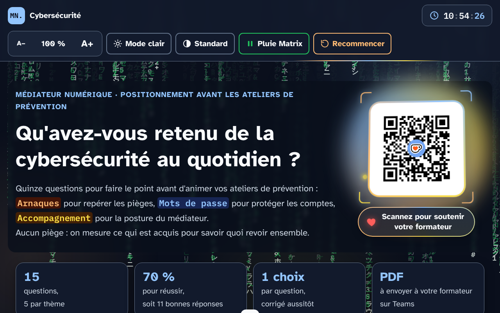
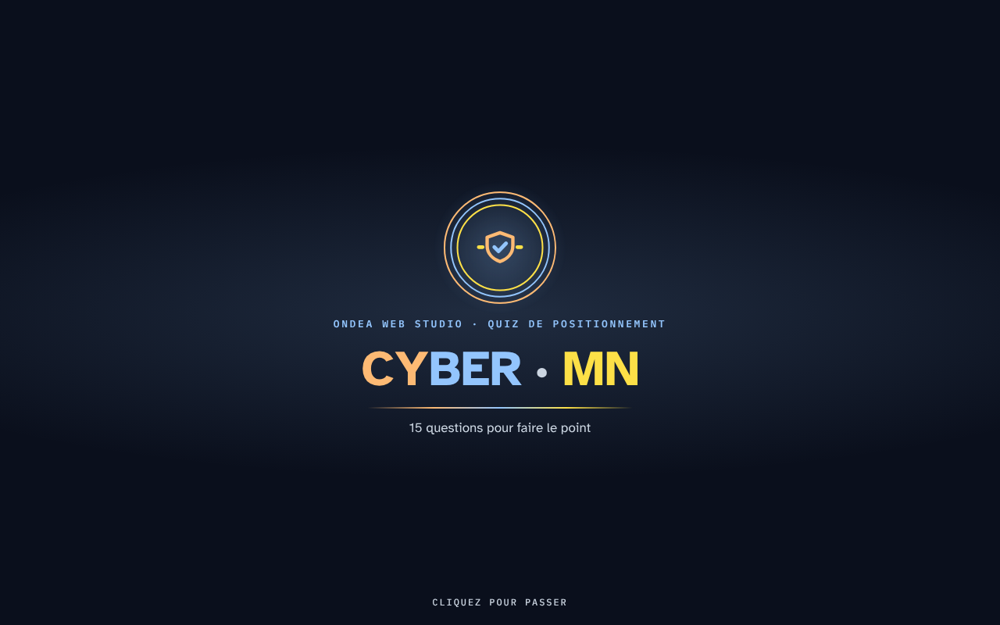
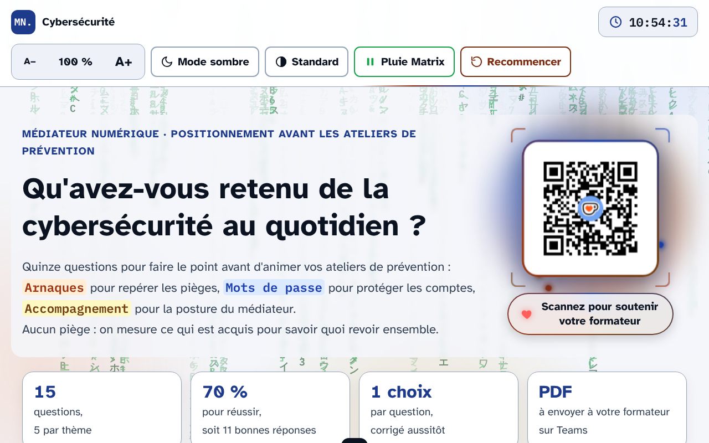
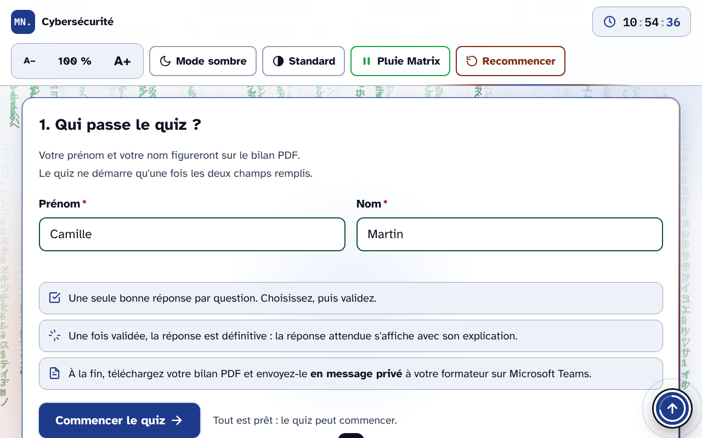
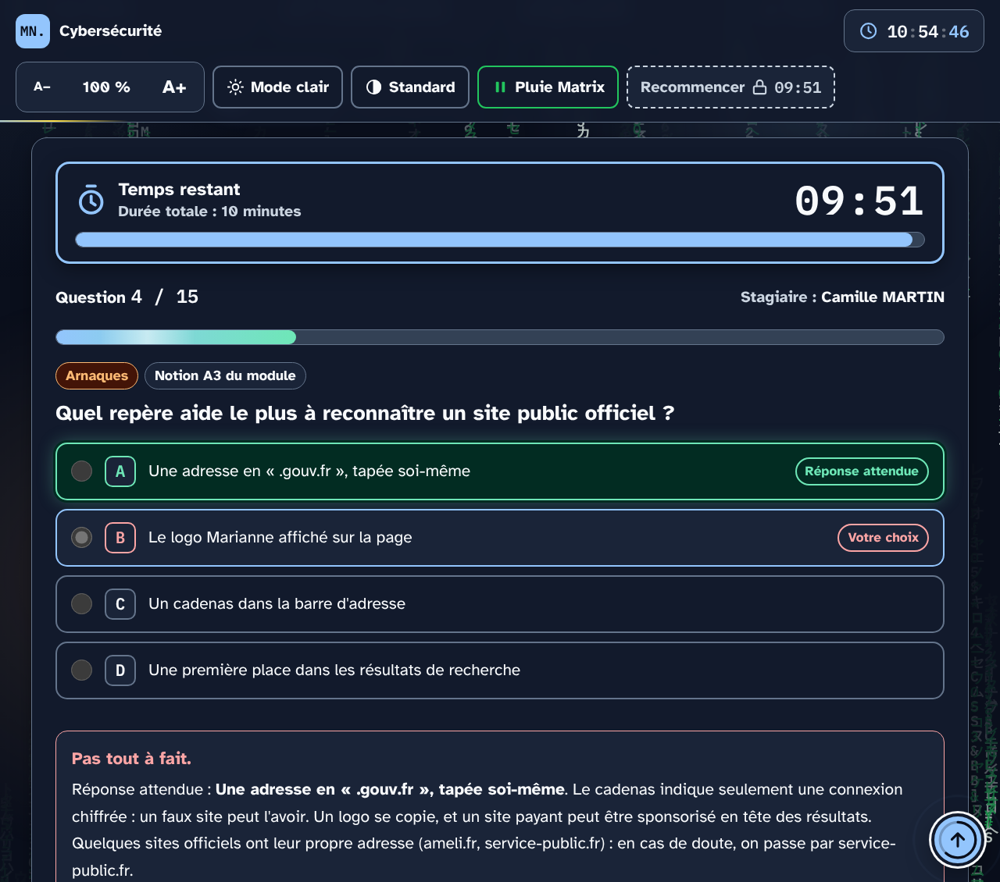
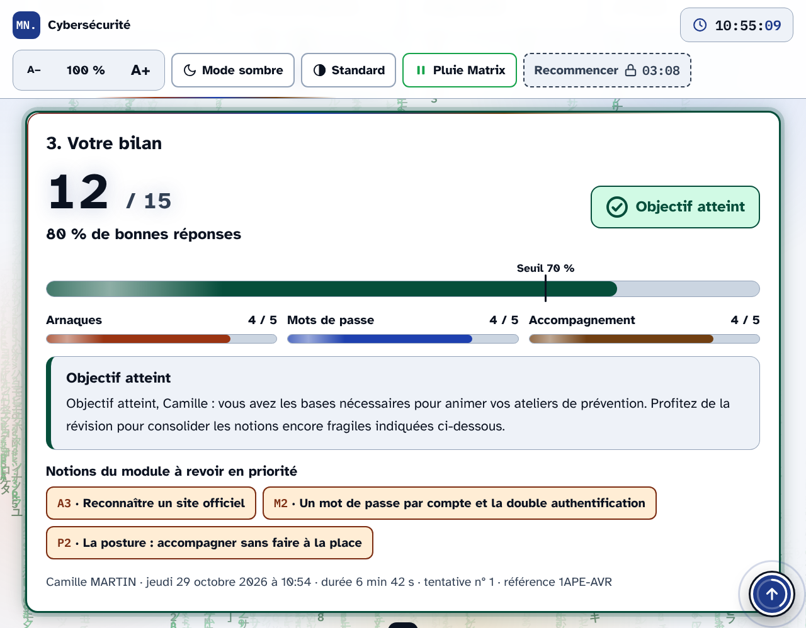
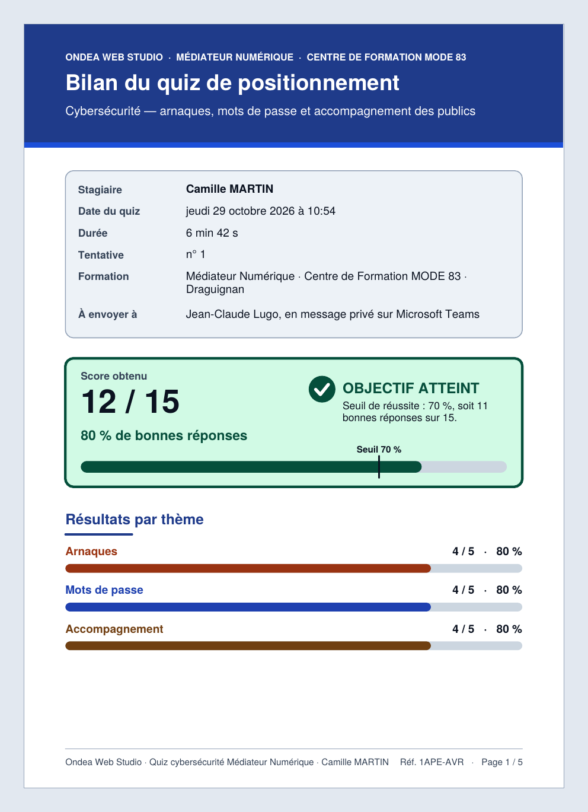
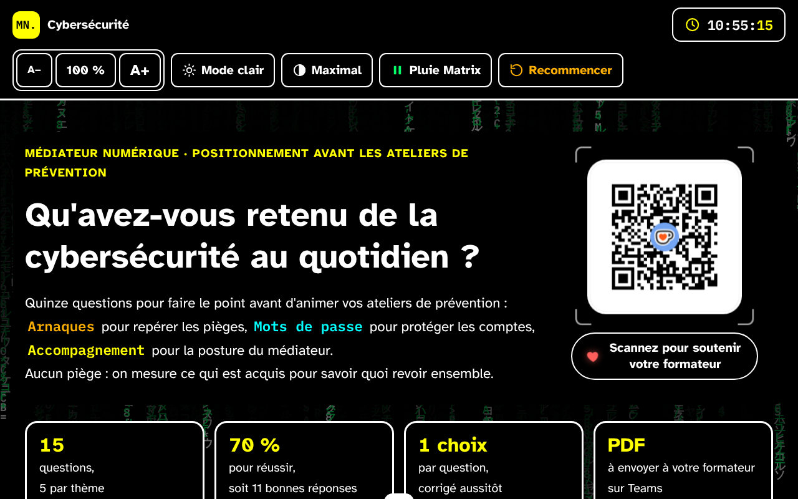
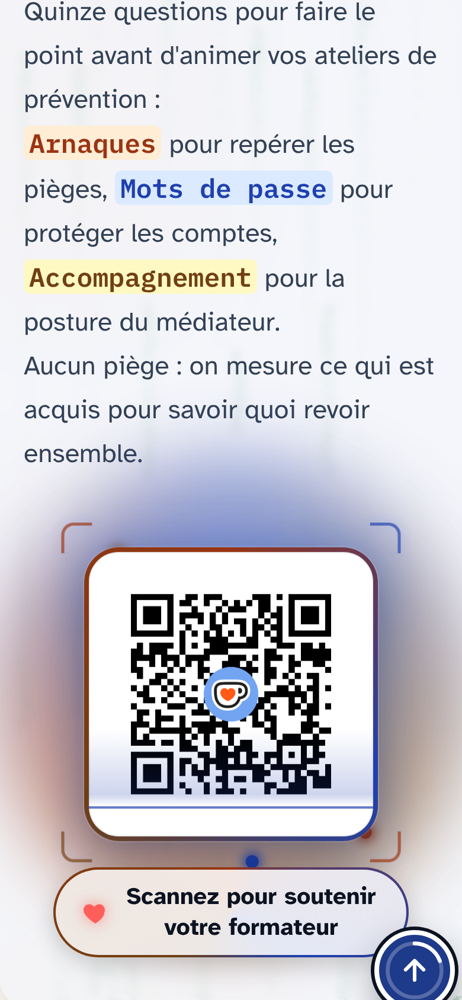
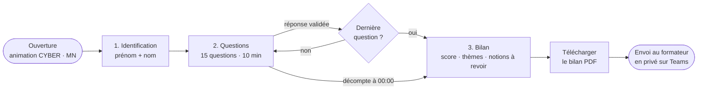

<div align="center">

# 🛡️ Quiz de positionnement Cybersécurité · Médiateur Numérique

**15 questions pour faire le point avant d'animer les ateliers de prévention**
Arnaques · Mots de passe · Accompagnement des publics

[](https://pythonman83.github.io/quiz-cyber-mn/)
[](https://www.francecompetences.fr/recherche/rncp/40695/)
[](#-structure-du-projet)
[](#-accessibilité)
[](#-mise-en-ligne-sur-github-pages)



</div>

---

## 📋 Sommaire

- [Présentation](#-présentation)
- [Aperçu en images](#-aperçu-en-images)
- [Parcours du stagiaire](#-parcours-du-stagiaire)
- [Fonctionnalités](#-fonctionnalités)
- [Contenu pédagogique](#-contenu-pédagogique)
- [Accessibilité](#-accessibilité)
- [Structure du projet](#-structure-du-projet)
- [Mise en ligne sur GitHub Pages](#-mise-en-ligne-sur-github-pages)
- [Personnalisation](#-personnalisation)
- [Données et confidentialité](#-données-et-confidentialité)
- [Compatibilité](#-compatibilité)
- [Dépannage](#-dépannage)
- [Auteur et soutien](#-auteur-et-soutien)

---

## 🎯 Présentation

Ce quiz de positionnement s'adresse aux stagiaires du titre professionnel **Médiateur Numérique (RNCP 40695)** du **Centre de Formation MODE 83** à Draguignan. Il se passe **avant les ateliers de prévention** en cybersécurité, pour mesurer ce qui est acquis et cibler la révision.

| | |
|---|---|
| **Questions** | 15, réparties en 3 thèmes de 5 questions |
| **Seuil de réussite** | 70 %, soit 11 bonnes réponses |
| **Durée** | 10 minutes, avec un décompte visible |
| **Correction** | immédiate, avec l'explication de la réponse attendue |
| **Résultat** | un bilan PDF nominatif à envoyer au formateur en message privé sur Microsoft Teams |
| **Technique** | un seul fichier `index.html`, sans serveur ni base de données |

---

## 🖼️ Aperçu en images

| Ouverture | Accueil (mode clair) |
|:---:|:---:|
|  |  |
| **Identification** | **Question en cours** |
|  |  |
| **Bilan à l'écran** | **Bilan PDF** |
|  |  |
| **Contraste maximal** | **Mobile** |
|  |  |

> 📸 Captures réalisées sur la page réelle du quiz, avec une stagiaire fictive (Camille Martin) : 1280 px de large pour les vues d'ordinateur, 390 px pour la vue mobile. Elles se trouvent dans `docs/captures/` (voir la [structure du projet](#-structure-du-projet)).

---

## 🧭 Parcours du stagiaire



1. **Identification** : prénom et nom obligatoires (lettres, espaces, tirets, apostrophes). Le bouton « Commencer le quiz » reste inactif tant que les deux champs ne sont pas valides.
2. **Questions** : une seule bonne réponse par question. Une fois validée, la réponse est définitive et la correction s'affiche avec son explication.
3. **Bilan** : score, verdict, jauge avec repère du seuil, résultats par thème, commentaire personnalisé, notions du module à revoir et détail des 15 réponses.

---

## ✨ Fonctionnalités

### Le quiz

- 🔀 **Ordre des réponses mélangé** pour chaque stagiaire et chaque tentative.
- ✅ **Correction immédiate** : bonne réponse en vert, mauvais choix en rouge, explication pédagogique.
- 💾 **Reprise automatique** : en cas de rechargement de la page, le quiz reprend à la question en cours.
- 🔢 **Numéro de tentative** mémorisé par stagiaire et inscrit sur le bilan.
- 🧾 **Référence unique** du bilan (empreinte du nom, de l'heure de départ et des réponses).

### Le décompte de 10 minutes

- ⏱️ Panneau collant en haut des questions, avec barre de progression.
- 🟠 **Moins de 5 minutes** : passage en orange, avec texte explicite.
- 🔴 **Dernière minute** : passage en rouge, bordure renforcée.
- 🔊 **Annonces aux lecteurs d'écran** à 10 min, 5 min, 2 min, 1 min, 30 s et 10 s.
- 🔒 À **00:00**, le quiz se verrouille, les réponses validées sont conservées et le bilan s'affiche. Les questions sans réponse sont marquées **« Sans réponse »** à l'écran et dans le PDF.
- 🚫 Les boutons **Recommencer** et **Nouvelle tentative** restent verrouillés jusqu'à la fin du décompte, avec le temps d'attente affiché.

### Le bilan

- 📄 **PDF A4 généré dans le navigateur** (bibliothèque jsPDF) : texte réel sélectionnable, grands corps, statut écrit en toutes lettres en plus des couleurs, nom de fichier automatique :
  `Bilan-quiz-Cyber-MN_NOM_Prenom_AAAA-MM-JJ.pdf`
- 🖨️ **Impression ou PDF balisé** : version papier en noir sur blanc, mode clair forcé quelle que soit l'apparence choisie à l'écran, idéale avec un lecteur d'écran.
- 💬 **Mode d'emploi Microsoft Teams** pas à pas pour l'envoi en message privé.

### L'habillage

- 🎬 **Ouverture animée** : anneaux tricolores, bouclier, titre lettre par lettre, rideau qui s'ouvre (clic ou touche pour passer).
- 🌧️ **Pluie Matrix** en arrière-plan, avec bouton pause.
- 🌌 Aurore colorée, halo qui suit la souris, cartes à projecteur, bordures lumineuses animées.
- ⬆️ **Bouton de retour en haut** avec anneau de progression, étincelles et sons générés (Web Audio).
- 📱 **QR code Ko-fi animé** à droite de l'en-tête (cadre tricolore tournant, faisceau de scan, inclinaison 3D), qui passe sous le texte sur petit écran.
- 🕒 Horloge en direct dans la barre d'outils.

---

## 📚 Contenu pédagogique

| Thème | Couleur | Questions | Notions du module |
|---|---|:---:|---|
| **Arnaques** | 🟧 orange | 1 à 5 | **A1** Les 3 signaux d'un SMS piège · **A2** Les bons réflexes et le 33700 · **A3** Reconnaître un site officiel |
| **Mots de passe** | 🟦 bleu | 6 à 10 | **M1** La recette d'un bon mot de passe · **M2** Un mot de passe par compte et la double authentification · **M3** Le gestionnaire de mots de passe |
| **Accompagnement** | 🟨 jaune | 11 à 15 | **P1** FranceConnect et le poste partagé · **P2** La posture : accompagner sans faire à la place · **P3** Orienter vers les bons relais |

Le commentaire de fin de quiz s'adapte au résultat :

| Score | Commentaire |
|---|---|
| 15 / 15 | Excellent : un sans-faute |
| ≥ 85 % | Très bon niveau |
| ≥ 70 % | Objectif atteint |
| ≥ 50 % | Objectif presque atteint |
| < 50 % | Bases à reprendre |

Il signale aussi le **point fort** (thème sans erreur) et le **point d'attention** (thème sous 60 %).

> ℹ️ Les réponses et explications se trouvent dans le tableau `Q` du fichier `index.html`. Comme pour tout site statique, elles sont lisibles dans le code source : le quiz est un outil de positionnement, pas un examen certificatif.

---

## ♿ Accessibilité

| Réglage | Détail |
|---|---|
| **Taille du texte** | 7 niveaux, de 85 % à 200 % (`A−` / `100 %` / `A+`) |
| **Thème** | clair ou sombre, avec respect de la préférence du système |
| **Contraste** | Standard, Renforcé ou Maximal ; les effets décoratifs s'effacent en contraste renforcé ou maximal |
| **Animations réduites** | la préférence « réduire les animations » du système désactive l'intro et les effets |
| **Police** | Atkinson Hyperlegible, conçue pour les personnes malvoyantes |
| **Lecteurs d'écran** | lien d'évitement, titres structurés, `fieldset` / `legend`, barres de progression ARIA, zones d'annonce, focus géré à chaque étape |
| **Clavier** | tout se fait au clavier, focus visible renforcé |
| **Couleur** | aucune information n'est donnée par la couleur seule : « Correct », « Incorrect », « Objectif atteint » sont toujours écrits |

Les réglages sont mémorisés sur l'appareil et partagés avec les mini-cours Ondea Web (mêmes clés `ondea-mc-*`).

---

## 🗂️ Structure du projet

```text
quiz-cyber-mn/
├── index.html          ← tout le quiz : HTML, CSS et JavaScript
├── qr-kofi.png         ← image du QR code Ko-fi affichée dans l'en-tête
├── README.md           ← ce fichier
└── docs/
    └── captures/       ← captures d'écran utilisées dans ce README
        ├── 01-intro.png
        ├── 02-accueil-sombre.png
        ├── 03-accueil-clair.png
        ├── 04-identification.png
        ├── 05-question.png
        ├── 06-bilan.png
        ├── 07-bilan-pdf.png
        ├── 08-contraste-max.png
        └── 09-mobile.png
```

**Ressources externes chargées par la page :**

- Google Fonts : *Atkinson Hyperlegible* et *IBM Plex Mono*
- cdnjs : `jspdf 2.5.1` pour le bilan PDF

---

## 🚀 Mise en ligne sur GitHub Pages

### 1. Créer le dépôt

1. Sur GitHub, cliquez sur **New repository**.
2. Nom conseillé : `quiz-cyber-mn`, visibilité **Public**.
3. Validez avec **Create repository**.

### 2. Envoyer les fichiers

**Par le site GitHub** : sur la page du dépôt, **Add file → Upload files**, déposez `index.html`, `qr-kofi.png`, `README.md` et le dossier `docs`, puis **Commit changes**.

**Ou en ligne de commande** :

```bash
git init
git add index.html qr-kofi.png README.md docs/
git commit -m "Quiz de positionnement Cybersécurité Médiateur Numérique"
git branch -M main
git remote add origin https://github.com/pythonman83/quiz-cyber-mn.git
git push -u origin main
```

### 3. Activer GitHub Pages

1. Dans le dépôt : **Settings → Pages**.
2. **Source** : *Deploy from a branch*.
3. **Branch** : `main`, dossier `/ (root)`, puis **Save**.
4. Après une à deux minutes, le quiz est en ligne à l'adresse :

```text
https://pythonman83.github.io/quiz-cyber-mn/
```

> 💡 Pensez à remplacer `pythonman83` et `quiz-cyber-mn` par votre nom d'utilisateur et le nom de votre dépôt, ici et dans le badge en haut de ce README.

### 4. Partager le lien aux stagiaires

Publiez le lien dans le canal Teams de la session, ou générez un QR code pointant vers l'adresse GitHub Pages pour l'afficher au vidéoprojecteur.

---

## ⚙️ Personnalisation

Tous les réglages se trouvent dans `index.html`.

### Formateur, formation et seuil

Dans le premier grand `<script>` du quiz :

```js
const TRAINER = {
  name: "Jean-Claude Lugo",
  role: "Formateur expert, Centre de Formation MODE 83",
  teamsEmail: ""   // facultatif : ajoute un bouton « Ouvrir la conversation Teams »
};
const PROGRAM = "Médiateur Numérique · Centre de Formation MODE 83 · Draguignan";
const PASS = 70;   // seuil de réussite en %
```

Si `teamsEmail` est renseigné, un bouton **Ouvrir la conversation Teams** apparaît sur le bilan.

### Durée du quiz

La durée est définie **à deux endroits** qui doivent rester identiques : le script du décompte et le script du verrou « Recommencer ».

```js
const DUREE = 10 * 60 * 1000;   // 10 minutes, en millisecondes
```

> ⚠️ Les textes affichés et annoncés (« vous disposez de 10 minutes », « Durée totale : 10 minutes », « décompte de 10 minutes ») et la valeur `10:00` des boutons verrouillés sont écrits en dur : modifiez-les aussi si vous changez la durée.

### Durée de l'ouverture animée

L'ouverture dure actuellement **8 secondes** avant que le rideau s'ouvre. Pour une durée de *N* secondes, ajoutez *N − 8* à chacune de ces valeurs :

| Où | Valeur actuelle (8 s) |
|---|---|
| `html.wow .wow-intro` → `wow-intro-off` | `8.9s` |
| `.wow-half--top` → `wow-open-up` | `8s` |
| `.wow-half--bot` → `wow-open-down` | `8s` |
| `.wow-seam` → `wow-seam` | `7.65s` |
| `.wow-stage` → `wow-stage-out` | `7.75s` |
| `.wow-skiphint` → `wow-stage-out` | `7.75s` |
| `html.wow{--wb:…}` (bloc style premium) | `8.15s` |
| `setTimeout(…, …)` de retrait de l'intro (en ms) | `9400` |

### Questions

Chaque question du tableau `Q` suit ce modèle :

```js
{ id:"q1", lang:"html", lesson:"a1",
  q:"Texte de la question",
  o:["Réponse 1", "Réponse 2", "Réponse 3", "Réponse 4"],
  a:0,                      // index de la bonne réponse dans o (0 = la première)
  why:"Explication affichée après validation" }
```

- `lang` : `html` = Arnaques, `css` = Mots de passe, `js` = Accompagnement.
- `lesson` : clé d'une notion du tableau `LESSONS`.
- Les accents graves `` `code` `` s'affichent en police à chasse fixe.

### QR code

- Remplacez `qr-kofi.png` par votre propre image (carrée, fond blanc).
- Le lien, le texte de l'étiquette et l'`aria-label` se trouvent dans le dernier `<script>` du fichier (bloc « QR code Ko-fi »).

---

## 🔐 Données et confidentialité

- **Aucune donnée ne quitte l'ordinateur** du stagiaire : pas de serveur, pas de formulaire envoyé, pas de statistiques.
- La progression est enregistrée dans le **`localStorage` du navigateur** :

| Clé | Contenu |
|---|---|
| `ondea-cyber-mn-quiz-state` | tentative en cours (nom, réponses, heures) |
| `ondea-cyber-mn-quiz-attempts` | nombre de tentatives par stagiaire |
| `ondea-cyber-mn-quiz-timeout` | tentative arrêtée par le décompte |
| `ondea-mc-theme`, `ondea-mc-contrast`, `ondea-mc-scale` | réglages d'affichage |
| `ondea-mc-matrix-v2` | pluie Matrix active ou en pause |

- Seul le **PDF généré** est transmis, volontairement, par le stagiaire à son formateur.
- Sur un **poste partagé**, le bouton **Recommencer** (une fois le décompte terminé) efface la tentative en cours et vide les champs nom et prénom.

---

## 🌐 Compatibilité

| Navigateur | Prise en charge |
|---|---|
| Chrome, Edge (versions récentes) | ✅ complète, y compris la transition circulaire du thème |
| Firefox (versions récentes) | ✅ complète |
| Safari macOS et iOS (versions récentes) | ✅ complète |
| Navigateurs anciens | ⚠️ le quiz fonctionne ; certains effets visuels sont simplement absents |

Une **connexion Internet** est nécessaire au premier chargement pour les polices et la bibliothèque PDF.

---

## 🛠️ Dépannage

| Problème | Solution |
|---|---|
| Le message « JavaScript ne s'exécute pas ici » s'affiche | Ouvrir le quiz dans un vrai navigateur (Chrome, Edge, Firefox), pas dans un aperçu de fichier. |
| Le bouton « Télécharger mon bilan PDF » ne fonctionne pas | La bibliothèque jsPDF n'a pas pu se charger (hors ligne, filtrage réseau) : la page ouvre automatiquement l'impression ; choisir **Enregistrer au format PDF**. |
| Le QR code ne s'affiche pas | Vérifier que `qr-kofi.png` est bien à côté de `index.html`, avec ce nom exact (GitHub Pages respecte les majuscules). |
| « Recommencer » est grisé avec un cadenas | Normal : il se débloque à la fin du décompte de 10 minutes. |
| Le stagiaire retrouve son ancienne tentative | La progression est mémorisée dans le navigateur : attendre la fin du décompte puis cliquer sur **Recommencer**. |
| L'ouverture paraît trop longue | Cliquer ou appuyer sur une touche pour la passer, ou réduire sa durée (voir [Personnalisation](#durée-de-louverture-animée)). |
| Les modifications n'apparaissent pas en ligne | Attendre une à deux minutes après le *commit*, puis recharger avec `Ctrl + F5`. |

---

## 👤 Auteur et soutien

**Jean-Claude Lugo** · Formateur expert au Centre de Formation MODE 83, Draguignan (Var)
Conception et développement : **Ondea Web Studio**

<div align="center">

[](https://github.com/pythonman83)
[](https://ko-fi.com/ondeaweb)
[](https://ljcwhisper8.gumroad.com)
[](https://payhip.com/OndeaWeb)


*Scannez pour soutenir votre formateur* ☕

</div>

---

<div align="center">

© 2026 Ondea Web Studio · Jean-Claude Lugo · Tous droits réservés
Quiz de positionnement cybersécurité du titre Médiateur Numérique (RNCP 40695)

</div>
